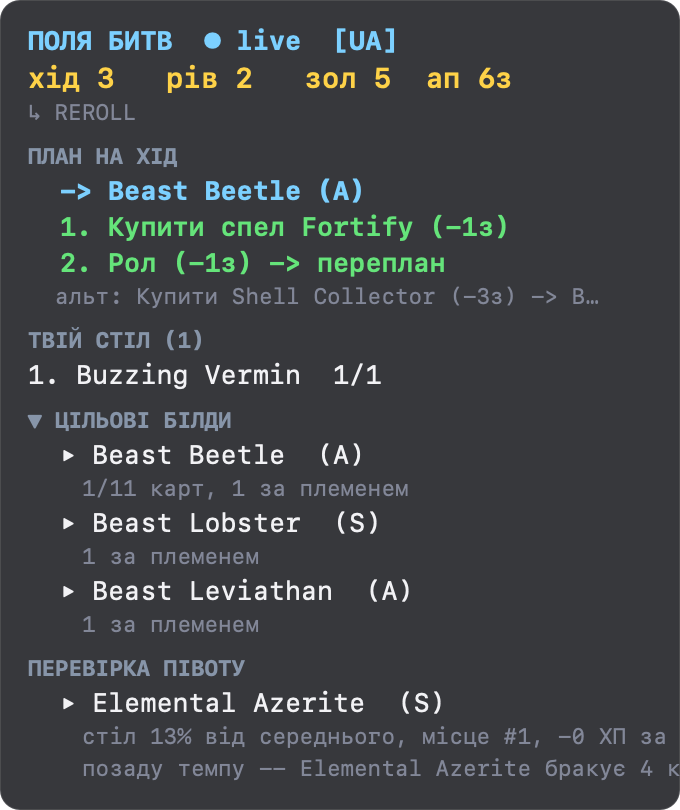
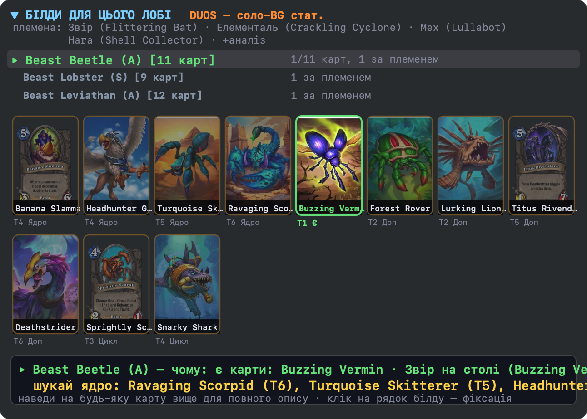
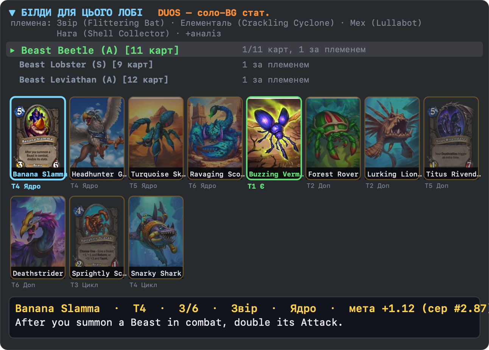

# hs-bg-agent

A Hearthstone Battlegrounds **human-in-the-loop turn-planning agent** and in-game macOS overlay: reads Hearthstone's local `Power.log` in real time, reconstructs the full Battlegrounds state, evaluates tavern states with a beam-search turn planner and Monte Carlo combat simulator, and renders floating per-card / tavern-action scores and interactive build guides directly over the game.

## Screenshots

### 1. In-Tavern Floating Score Badges (`▲ АП`, `↻ РОЛ`, and Shop Cards)
Floating score badges (`0..100`) are drawn directly above Bob's Tavern Upgrade button (`▲ АП`), Reroll button (`↻ РОЛ`), and each card in the tavern row. The highest-value action is highlighted in green (`★`). Badges automatically hide during the visual combat phase (`PowerTaskList` synchronization).


### 2. Live Turn-Plan & State Panel (Top-Left)
Shows live turn/tier/gold/upgrade cost, combat win/tie/loss simulation odds, Discover / Hero pick rankings, step-by-step recommended turn sequence (`ПЛАН НА ХІД`) with target composition and alternative line (`альт:`), current warband, and clickable target builds. Includes an on-screen `[UA]` / `[EN]` language toggle.



### 3. Interactive Lobby Builds & Selection Explanation (`чому:` / `шукай ядро:`)
Collapsed by default into a compact bottom-left panel; hovering or clicking (`🔒` lock) any build expands all 7–15 cards of that composition and explains **why** the agent selected that build for your current board/lobby and which core cards to look for next.



### 4. Per-Card Hover Inspector
Hovering any card inside an expanded build displays its tier, stats, tribe, role (`Ядро` / `Доп` / `Цикл`), meta impact, and full card ability text.



---

## Architecture & Scope

```
Hearthstone -> Power.log -> parser (GameState + PowerTaskList sync)
            -> BGState + OpponentTracker + TribeTracker
            -> GameSnapshot & MinionPool (tavern.py)
            -> ValueFunction (value.py) + CombatSimulator (combat.py, ~18k sims/s)
            -> Beam-Search TurnPlanner & Positioning Optimizer (planner.py)
            -> Cocoa/Quartz Overlay (tools/overlay.py) / CLI (tools/live.py) / Gym Env (env.py)
```

Instead of scoring single cards in isolation, `TurnPlanner` searches sequences of legal tavern actions (`BuyMinion`, `BuySpell`, `SellMinion`, `PlayMinion`, `PlaySpell`, `UseHeroPower`, `UpgradeTavern`, `RollShop`, `FreezeShop`, `ReorderBoard`, `EndTurn`) under the gold budget, adjusts roll EV using the lobby-filtered `MinionPool`, and re-plans after every stochastic event.

Closed-loop autonomous execution (`perceive -> plan -> act`) is provided in `BGGymEnv` (`src/hsbg/env.py`) for offline evaluation and RL/search benchmarking. **Out of scope**: OS-level auto-clicking in live PvP lobbies.

## Run it

```bash
tools/capture.sh                          # snapshot a session's logs
tools/replay.py [capture/Power.log]       # replay one, print state transitions
tools/plan_replay.py [capture/Power.log]  # replay one, print turn-by-turn plans
tools/eval_agent.py [capture/Power.log]   # offline benchmark (latency, action match, combat accuracy)
tools/live.py [--lang uk|en]              # live state + turn plan in the terminal
.venv/bin/python tools/overlay.py         # live state + turn plan as an in-game overlay (click [UA]/[EN] to switch language)
pkill -USR1 -f tools/overlay.py           # hide/show everything
pkill -USR2 -f tools/overlay.py           # hide/show just the builds panel
pkill -f tools/overlay.py                 # quit it
```

Data refresh (cached, safe to re-run):

```bash
tools/fetch_carddb.sh      # card metadata, ~10 MB, after each patch
tools/fetch_stats.py       # meta stats, weekly
tools/fetch_art.py         # card images for the comps
```

## Setup

Hearthstone only writes `Power.log` when `log.config` enables it, and defaults to a 10 MB per-file log cap (`MaxFileSizeKilobytes = 10000`) unless disabled in `client.config`:

```bash
cp docs/log.config ~/Library/Preferences/Blizzard/Hearthstone/log.config
printf "[Log]\nFileSizeLimit.Int = -1\n" > /Applications/Hearthstone/client.config
```

Hearthstone must be **fully quit** first -- the file is read once at startup.
Delete it and restart to turn logging off again.

To check it is working, look at which files exist in the newest session under
`/Applications/Hearthstone/Logs/`. `Asset.log`, `LoadingScreen.log` and `Net.log`
present means the config was read. `Power.log` and `Zone.log` appear only once a
match starts. Do **not** rely on the `Failed to load config file:` line in
`Hearthstone.log` -- it appears even when logging works correctly.

The overlay needs a virtualenv with pyobjc:

```bash
python3 -m venv .venv && ./.venv/bin/pip install pyobjc-framework-Cocoa pyobjc-framework-Quartz
```

## Layout

```
src/hsbg/parser.py    Power.log lines -> typed events
src/hsbg/state.py     entity store, and the Battlegrounds projection over it
src/hsbg/tail.py      follows the live log across game restarts
src/hsbg/carddb.py    cardId -> name, tribe, tier, text
src/hsbg/stats.py     meta statistics and composition data
src/hsbg/advisor.py   contextual scoring, build detection, tribe detection
src/hsbg/tavern.py    immutable GameSnapshot, MinionPool, and pure tavern transitions
src/hsbg/value.py     state-level value function V(snapshot) -> ValueBreakdown
src/hsbg/planner.py   beam-search turn planner + positioning optimizer
src/hsbg/combat.py    combat simulator (~18k sims/s, deathrattles, auras, cleave, triggers)
src/hsbg/env.py       headless closed-loop Gym environment (BGGymEnv)
src/hsbg/i18n.py      Ukrainian (uk) and English (en) localization
src/hsbg/art.py       card images, cached
tools/                capture, replay, live view, overlay, data fetchers
docs/                 findings, log.config reference
TODO.md               phased roadmap from heuristic advisor to turn-planning agent
```

## What works

* **Full Battlegrounds state perception (`state.py`)**: Shop (minions + Tavern Spells), board, hand (minions + spells), gold, dynamic reroll & buy costs, tavern tier & upgrade cost, active Hero Power (`HeroPower`), trinkets, hero offers, Discover choices, freeze state, pairs/triples, turn & visual combat phase sync (`VISUAL_TURN`), leaderboard placement, and `OpponentTracker`.
* **Tavern transition model (`tavern.py`)**: Immutable `GameSnapshot`, lobby-filtered `MinionPool`, legal action enumeration, deterministic economy/buff spell & battlecry transitions, and triple synthesis.
* **Beam-search Turn Planner & Value Function (`value.py`, `planner.py`)**: Multi-step turn planning (`buy / sell / play / upgrade / hero power / roll / freeze / reorder`), curve-aware tier upgrade valuation, Expectimax pool-adjusted roll EV, and Monte Carlo combat positioning optimizer (`optimize_positioning`).
* **Validated Combat Simulator (`combat.py`)**: ~18,000 simulations/sec on 4v4 boards with 38+ deathrattles (including `Leapfrogger` recursion and `Titus Rivendare` multiplier), board auras, cleave, start-of-combat, on-attack rally triggers, Venomous, Divine Shield, and Reborn.
* **Interactive Cocoa/Quartz Overlay (`tools/overlay.py`)**:
  * Floating per-card score badges plus Tavern Upgrade (`▲ АП` / `▲ UP`) and Reroll (`↻ РОЛ` / `↻ ROLL`) score badges directly above Bob's tavern row (auto-hidden during visual combat).
  * Interactive bottom-left Builds panel: click-to-lock (`🔒`), collapsible into a compact pill (`▶ БІЛДИ`), displays all 7–15 cards per composition, explains build selection (`чому:` & `шукай ядро:`), and includes a per-card hover inspector.
  * Bilingual UI (`uk` Ukrainian default / `en` English) with an on-screen `[UA]` / `[EN]` click toggle.
* **Headless Gym Environment & Benchmarks (`env.py`, `tools/eval_agent.py`)**: Closed-loop `BGGymEnv` (`reset / step / play_episode`) for offline agent benchmarking.

Verified against real captured games -- see `docs/findings-01-power-log.md` and
`docs/findings-02-combat-rules.md` for the log format and the combat rules.

## Limitations

* **Duos is detected but uses solo-BG meta statistics.** In a Duos match the overlay displays a warning badge (`DUOS — соло-BG стат.`).
* **Targeted Battlecries / Choose One prompts** that require secondary sub-choices after playing a card are approximated at the state-value level rather than branching interactive sub-menus.

## Notes worth keeping

* Parse only `GameState.DebugPrintPower()`. Every power is logged twice; the
  `PowerTaskList` copy is the animation queue.
* Shop and board both live in `ZONE=PLAY`, told apart by the entity's `player`
  id. Bartender Bob is the player slot with a null `GameAccountId`; ids vary per
  game, so never hardcode them.
* The `TURN` tag counts combat phases too, so it runs at double the
  Battlegrounds turn. Gold is the check: `min(10, turn + 2)`.
* Discover arrives on `DebugPrintEntityChoices`, resolutions on
  `DebugPrintEntitiesChosen` -- different channels from `DebugPrintPower`.
* Only a *single*-tribe minion proves its tribe is in the lobby; dual-tribe
  cards are ambiguous evidence.
* State that lives only in a running process (the tribe slate, the Duos flag)
  needs resetting on `CREATE_GAME`. Replaying a capture always starts clean, so
  bugs of this kind are invisible to replay testing.
